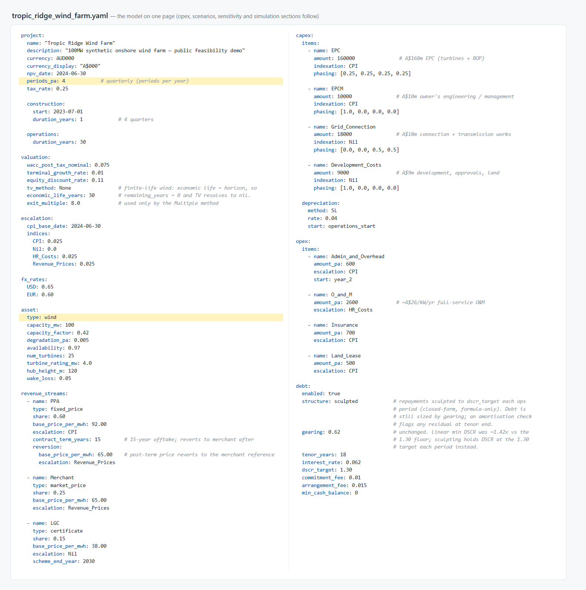
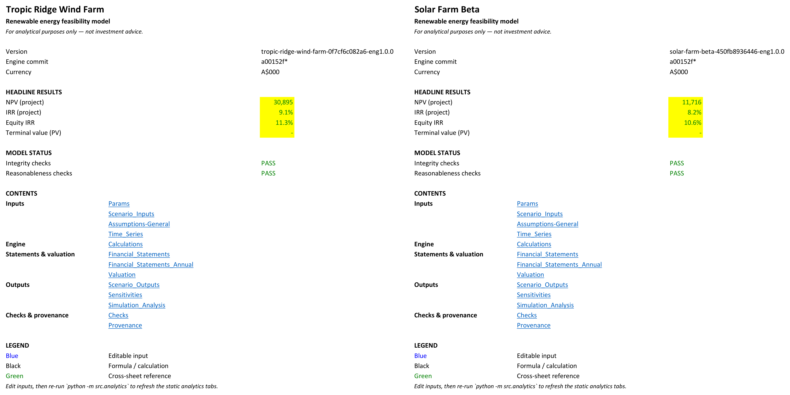
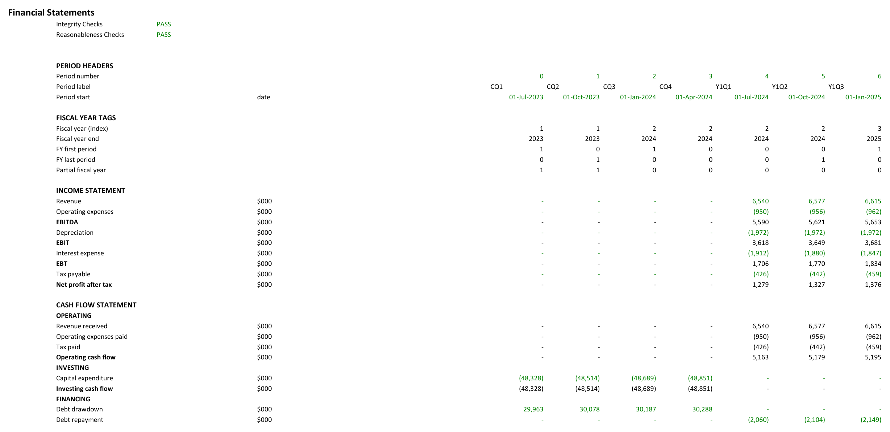
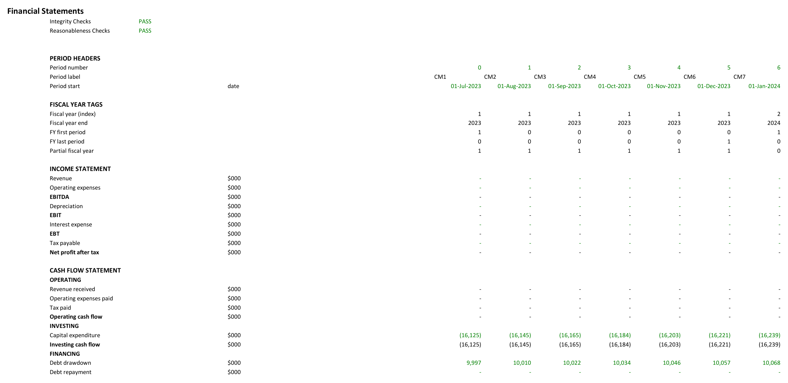
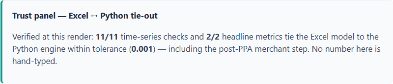
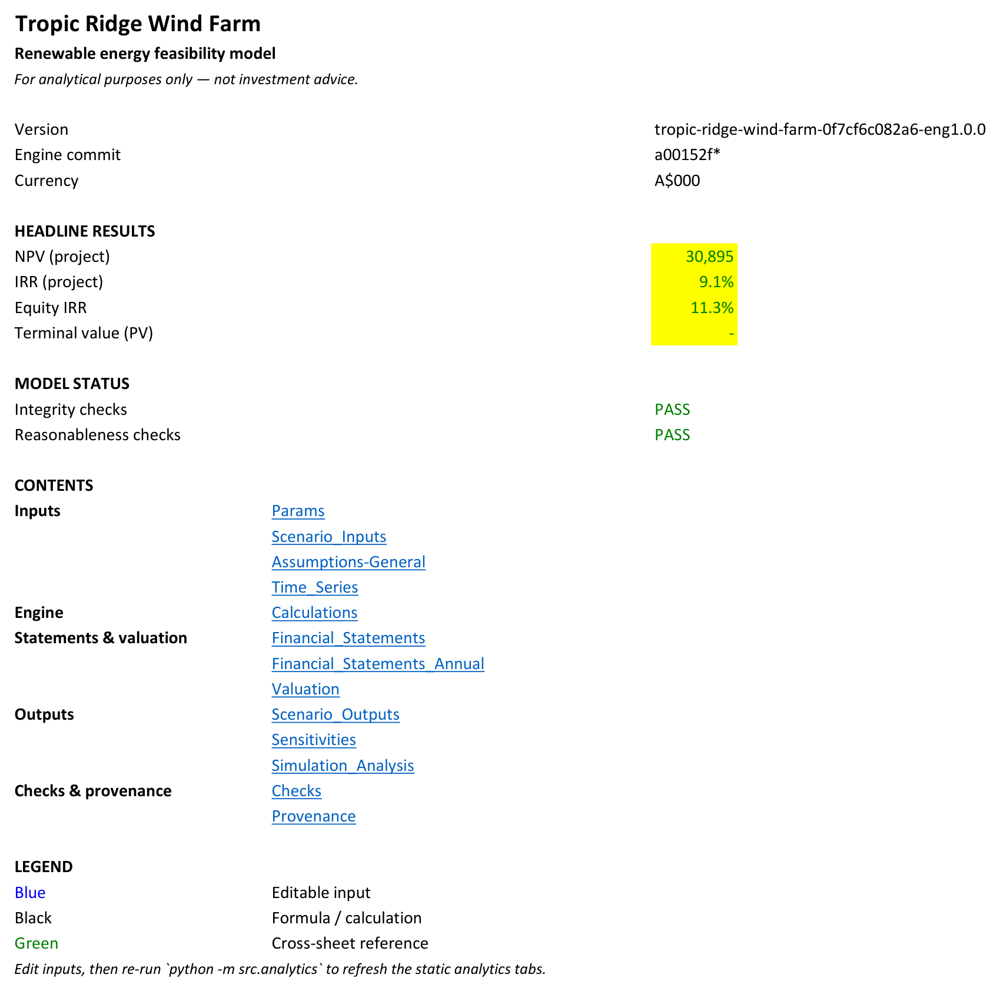

*(A separate series covers the QRA/SRA risk quantification platform — different project, same working method.)*

For most of my career, a financial model meant a spreadsheet. Excel is where the assumptions live, and where a lender or an investment committee can open a cell and see exactly how a number was built. That auditability is its strength, and it is why Excel has outlasted every tool meant to replace it.

The trade-off is that a large spreadsheet is slow to build, easy to break and hard to test. Excel is also not great at advanced analytics. Even Monte Carlo simulation is VBA or add-in reliant. Reporting is generally of the cut-and-paste variety, unless you go the VBA/Word route (which I am very adept at and would strongly recommend against).

New tools change the equation. I now work with AI (Claude is my friend and colleague), Python for analytics and cross-checks, and Quarto for reporting. More tools, and in my experience they integrate well, with Excel staying at the centre.

## The model is a config file

The renewables model I have been building starts from a single specification: capacity, capacity factor, capital cost and phasing, revenue contracts, debt terms, tax. One page of structured text — I use YAML, but think of it as a config file. It holds the model's shape and starting assumptions, and no formulas. Everything else is generated from it.

From that one file, deterministic Python code produces three deliverables:

- an Excel workbook, with assumptions in blue, formulas in black, checks, scenarios, sensitivities and headline KPIs. A normal, fully functional three-statement DCF that stands alone. No Python, no AI and no add-ins are needed to use it. This is the working model an analyst takes forward.
- a Python engine that mirrors the same calculations and adds the analytics Excel struggles with: Monte Carlo simulation, sensitivity sweeps, multi-scenario runs (yes, ok, data tables and VBA help with all this but more as permanent workarounds).
- a skeleton feasibility report with the tables and charts already populated, ready for the analyst to add narrative. No copying and pasting numbers.

{fig-alt="Two-column view of the Tropic Ridge YAML spec with the periods_pa and asset type lines highlighted"}

Press the button twice and you get two identical workbooks - reproducibility. While that sounds like a small, obvious thing, it is really the key thing, and never safely assumed when working in Excel. As the model is generated by code, it can be regenerated at will, and every model comes off the line with the same named ranges, the same checks sheet and the same documentation of itself.

This is different from asking an AI chatbot in a spreadsheet to build you a model. The AI did help write the generator, under a gated process, before any model existed. But once the code is written generation is deterministic. The AI decided no numbers, and by the time a model is produced it is no longer in the room.

## Most of a model is the same model

Anyone who builds bottom-up project models knows the pattern. The debt and equity mechanics, capex phasing, escalation, payables and receivables, tax, the checks and balances, the scenario and sensitivity apparatus: most of it is the same job (at most variations on a theme) on every project. What actually moves the most is the operating engine room, how the business earns. And even operating modules group into families.

The generator is built that way. A shared spine handles timing, escalation, capex, debt, tax, equity, cash flow and valuation, and asset modules plug into it. Today there are two, wind and solar, and the plug point is designed for more. Change one line of config, `asset.type: wind` to `solar`, regenerate, and you get the same spine with a different engine room.

{fig-alt="Tropic Ridge Wind Farm and Solar Farm Beta Excel cover sheets side by side, each with headline KPIs and PASS status banners"}

It's the same with the time dimension. The model's grain is one config line. Flip `periods_pa: 4` to `12` and regenerate, and the whole model is now monthly instead of quarterly. The annual summary view still ties in, because it aggregates by fiscal-year labels rather than by column positions.

{fig-alt="Financial Statements sheet at quarterly grain, construction quarters then operating quarters"}

{fig-alt="The same Financial Statements sheet at monthly grain, generated from the same spec with periods_pa flipped to 12"}

And the config does not have to be YAML. The generator ships a blank Excel spec template, and an extractor that reads a workbook back into config form, so the input can live where analysts live.

## But no two projects are the same

They can be similar, but generally the structure will have to be altered - we have a new debt structure, new tech means operating modules need to be tweaked etc etc. But the Excel model is now stand-alone so can be changed 'manually' by the analyst just like any other spreadsheet project model.

The issue is that the moment the analyst edits the workbook, it and the engine begin to diverge - regenerating now gives you back the original model, not the analyst's. So some extra steps are required to keep the two in sync.

This is the subject of the next blog. The short answer though is that the engine reconciles the workbook line by line across the full life of the project, and the check fails closed, meaning it cannot report a pass it did not earn. The workbook carries its own provenance (which spec version built it, and whether any input has moved since), and the report displays the live reconciliation result instead of asserting one. Excel is the source of truth for assumption values; the engine is the source of truth for calculation logic; drift between them is detected and classified, with an audit trail, before it reaches a reviewer.

So if the analyst makes a structural change, the reconciliation identifies it, locates it, and marks it for resolution. Resolving it is a code change — reviewed, tested and versioned using an AI-assisted development session. The engine never rewrites itself off the back of a spreadsheet edit. That is a key control - the engine is the sole source of truth for structure, not the Excel spreadsheet.

Assumption values are the easier case as the spreadsheet is the sole source of truth for assumption values. An approved change is written back to the config as a new version automatically, and the models are in sync again.

Change logs and versioning document both.

{fig-alt="Report trust panel stating 11 of 11 time-series checks and 2 of 2 headline metrics tie Excel to the Python engine within tolerance"}

## A worked example: Tropic Ridge

To have something showable, I run a synthetic 100 MW wind farm called Tropic Ridge. The assumptions are realistic-ish for an onshore site; there is no real client anywhere near it. The workbook lands with the usual KPI set on its cover — NPV, project and equity IRR, minimum DSCR, payback, terminal value — plus scenario tables, sensitivity tornadoes and Monte Carlo distributions beside them. The values are synthetic, so the outputs are meaningless - just there to populate screenshots. The point is what arrives already built, before an analyst has touched anything.

{fig-alt="Tropic Ridge Wind Farm Excel cover sheet with version stamp, headline results, PASS status banners and a hyperlinked table of contents"}

## The model comes to life

Anyone who has built a big model knows the long dead stretch before it comes to life: hours and hours of plumbing before the first real scenario run. I don't know about the rest of you, but I more or less gritted it out until the three statements came to life, at least in initial form. Then I could finally start my real job.

This generation process collapses that stretch - the plumbing arrives finished (more or less), checked and documented. So the dead stretch goes and the real job starts on day one.

Next in this series: the verification layer in full — the reconcile that fails closed, the workbook that describes itself, and what happens when someone edits a cell.

Tropic Ridge is a synthetic project, and everything here is for analytical and illustrative purposes only, not investment advice.
