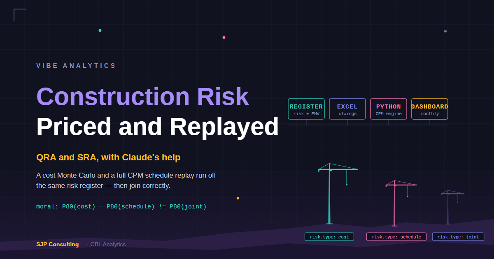

*Tropic Ridge Wind Farm is a fictional project (which I also use for demonstrating new DCF modelling techniques). While this model is purely for demonstration purposes, the methodology is real and is the same one I ran on
a live infrastructure engagement.*

## What we Built

I was invited to assist with risk quantification for a contractor bidding on a major infrastructure project.
For various reasons we did not go with an 'off-the-shelf' tool, but rather decided to use an Excel/Python solution, developed to suit this particular project.
This would not have been possible a year ago, as I needed the research, build and speed capabilities of AI, Claude in this case. The case study I have developed uses the methodology but not any project specifics of the client engagement.

The analysis produced:
 - Initial Quantitative Risk Analysis (QRA) and Schedule Risk Analysis (SRA), using integrated (ie joint QRA/SRA sampling) Monte-Carlo modelling, with supporting analysis.
 - Spreadsheet, Notebook, and webapp dashboard reporting.
 - An active management risk analysis for use during the construction period (once contract won) to update both probabilistic quantification and completion date estimates on project manager and risk analyst dashboards.

The tools used:
 - Excel is used by risk analyst to run the register and review initial QRA and SRA results, with EMV (Expected Monetary Value) sanity checks on both.
 - xlwings lite as free stand-alone python add-in to Excel to run monte-carlo analyses without any python installation required.
 - Full Python model to receive project schedule (ie P6 or similar) and do full SRA CPM analysis (ie allowing for floats etc) as well as QRA (which controls exactly to Excel version)
 - Claude AI assisted in initial build of Python models (including xlwings version), but not required once operational.
 - Claude in Excel was also used to assist in spreadsheet development and polishing (although the spreadsheet was written by Claude Code, with Claude in Excel assistance). Also not required once operational.
 - webapp (Vercel)
 - notebook of choice (we used Quarto)

My main take from this exercise was that I will probably never do any more Excel or VBA development without AI, and I have spent a career doing this stuff.
I will probably also never write another line of Python code, not that I have ever written much code anyway - I do finance and data analytics, not software development.
I will however do much more, much better and much faster analysis, with these additional tools.

The other take I had, probably belatedly, I no longer need to use VBA (hooray!) as xlwings lite python seems much better, working without cloud support and requiring no python installation.
And if I need reports, I use Python to transfer to notebooks - so no MS Word required (more hoorays!)

Incorporating checks and balances in both the Python code development and the Excel spreadsheet. For the Python code, we used a 4-hat approach which I have described previously, with Claude wearing most of the hats.

Its also worth noting that while this analysis is software in nature it was not developed as an 'app'. It is a tool to facilitate the analysis. The value lies in the analysis and related knowledge not in the tool, which was built by Claude with my direction to meet the specific requirements of this analysis, not as a generic software app. That does not mean it is not replicable though.

The rest of this post walks through what we put together, using a synthetic project we made up called Tropic Ridge Wind Farm - a $50M wind farm with 171 scheduled activities and a 35-risk register with a pre-construction P80 risk total (cost/schedule total) of $6.84M at P80 all of which traces back to a specific named risk.

## Excel Spreadsheet

The spreadsheet contains a normal risk register for base cost and event risks including risk description, quantification, mitigation and classification components as well as monte carlo inputs for both the QRA and SRA (including allowance for correlations) and activity mapping that links scheduled activities to risks. It also provides some initial non-mc analyses using deterministic (eg EMV) QRA and SRA (the latter being only a conservative ballpark).

The spreadsheet also includes a monte-carlo analysis for the QRA only, using a vectorised Python engine in the xlwings add-in to Excel. The Python engine is invisible to register users except for the button they need to push to update the results.

The spreadsheet is intended to be 'owned' by the risk register maintainer, who does not need to be a risk technical specialist, but can obviously run both roles if preferred.

So the spreadsheet, with its xlwings addin, provides a full monte carlo driven QRA and with acceptable speed even at the 100k iterations we are running. So if only QRA is required with associated S curve and related analytics, the analysis can stop here with results all being presented by way of the stand-alone spreadsheet itself - and the data has not left the xlsx spreadsheet file.

SRA requires more detailed analytics of the Primavera P6 report (or equivalent) which is only in the full Python model. Also, as the reporting options are more comprehensive in the full model and there is potential for project aggregation (which we have not yet turned on), it might suit to run all projects through the full model even if SRA not required. We are working on integrating the full SRA mc analysis into the stand-alone spreadsheet as well, although the full web app version will still have obvious advantages.

<!-- IMG SLOT: themed register / dashboard sheet (T1/T2 gate) -->

## Python Model

Once the excel register is connected to the full Python model (which could be on the same laptop, network or just an internet connection), the Python model can extract all required information and run a more detailed analysis, also using the P6 (or equivalent) report

I could have buried all of that in a database and presented the client with an
app. I did not, because the register has to live where the risk manager lives,
and the risk manager may or may not have a Python connection. The workbook
works standalone: it carries its own expected-value calculations, so it earns
its keep before any simulation exists. And when the simulation does exist, an
auditor can walk from any P-value in the report back to a named risk in a
named cell. No black box, no benchmark blend.

## EMV: the first answer, and the standing cross-check

Expected monetary value is probability times consequence, summed. For Tropic
Ridge's register it takes about a column of formulas, and it is the right
first-pass quantification: cheap, transparent, and immediately useful for
ranking risks.

It is also, on its own, not enough to set contingency. An EMV is a mean. It
says nothing about the tail, nothing about what happens when risks land
together, and it cannot give you a P80 because it has no distribution to take
a percentile of. Treating a summed EMV as a contingency figure quietly assumes
the average year, and boards do not fund projects for the average year.

So EMV plays two roles in my method, and keeps both for the life of the
project. It is the first answer, and it is the standing reasonableness check:
after every simulation run, the MC mean is reconciled back against the EMV.
When two methods of different sophistication agree on the middle of the
distribution, the fancier one has earned some trust in the tail.

## Two simulations, one register

From that same workbook, without re-entering anything, the platform runs
100,000 Monte Carlo iterations on the cost side and a full schedule replay on
the other.

The cost arm samples each risk's probability and three-point severity and
produces the familiar S-curve and tornado. For Tropic Ridge, cost risk lands
at $5.41M at P80.

<!-- IMG SLOT: cost S-curve + tornado (outputs/wind_showcase/figs) -->

The tornado chart is a leave-one-out contribution
ranking, not a textbook variance decomposition. It answers "what moves the
P80 if this risk goes away", which is usually the question being asked.

The schedule risk engine parses the project
programme - all 171 activities and their logic links - and then re-solves
the critical path inside every one of the 100,000 iterations. A risk that
fires on an activity with float gets absorbed by the float. A risk that fires
on the driving path moves the completion date. Nothing is muted or scaled by
a prior judgement about what matters; the network decides, iteration by
iteration, which is the approach AACE's recommended practice 65R-11 points
to. Schedule risk lands at 53.6 days at P80, which at Tropic Ridge's delay
rate is $1.88M.

<!-- IMG SLOT: schedule finish S-curve + activity criticality chart -->

A useful by-product: because the critical path is discovered rather than
assumed, the engine reports how often each activity actually drove the finish
date. Of 171 activities, 39 sat on the driving path essentially always. The
interesting ones are the handful that only become critical when particular
risks fire. A static schedule review cannot see those.

As a cross-check, I also ran the schedule side through a conventional
duration-shock model of the kind most practitioners would recognise. It
returned 47 days at P80 against the replay's 53.6. Same neighbourhood, and
the gap is informative rather than embarrassing: the replay carries full risk
impacts into a live network and sees the fuller tail. When an independent,
simpler method lands in touching distance of the sophisticated one, that is
what defensibility looks like.

## The join, and the $450k that was not there

Here is the beat this whole post exists for. You now have a cost P80 of
$5.41M and a schedule P80 of $1.88M. The obvious move is to add them:
$7.29M. It is also wrong, and it is wrong in the industry's favourite
direction - too conservative to be right, too plausible to get challenged.

A P80 is a percentile, and percentiles do not add. Adding them assumes the
bad cost year and the bad schedule year always arrive together. Some of
Tropic Ridge's risks genuinely do hit both at once - ten of the thirty-five
are dual-coded, and in the simulation those share a single severity draw per
iteration, so when the turbine delivery risk fires badly, it fires badly on
both books. But the rest diversify, the way real project years do.

The platform therefore takes the percentile after summing each iteration's
cost and schedule outcome, not before:

| Basis | P80 |
|---|---|
| Cost arm | $5.41M |
| Schedule arm (dollarised) | $1.88M |
| Naive sum of P80s | $7.29M |
| Integrated (joint simulation) | $6.84M |

The joint figure is $0.45M under the naive sum - about 6.6%. On a synthetic
$50M project that is a rounding-error-sounding number that is also most of a
million dollars of contingency the naive method would have locked away for
weather that cannot all happen at once. On the real projects this method
serves, the gap scales.

## A photograph, not a film

Everything above is the baseline: the number the project takes to sanction,
with its confidence level attached and its audit trail intact. Every run is
seeded and stamped - iteration count, inputs, engine version - so the same
register produces the same figures next month, or the discrepancy has to
explain itself. The figures were cross-validated between two independently
built engines before any of them appeared in this post.

But a contingency study is a photograph. Projects move. The month after
sanction, three of those risks will have grown, two will have retired, and
the P80 will have quietly become a different number that nobody has
recalculated. What that looks like - a monthly cycle where the register, the
simulation and a live dashboard move together, with every movement attributed
to the risk that caused it - is the next post.

## By the numbers

- 100,000 Monte Carlo iterations per production run (seeded, so
  identically re-runnable, which auditors enjoy more than surprises)
- 171 scheduled activities, critical path re-solved in every iteration
- 35 risks, 10 of them hitting cost and schedule together
- $0.45M: the contingency the naive method books for correlations that
  do not exist
- Lines of Python written by me: approximately none (I have a build team
  for that; it happens to be Claude, working under a gated process with
  locked tests - a story for another post)

*Stephen Parton is a chartered accountant and consultant with 30-plus years
in finance and risk across banking and infrastructure. SJP Consulting builds
quantitative risk tooling under the CBL Analytics banner. If your contingency
is a round number with a straight face, [get in touch on
LinkedIn](https://www.linkedin.com/in/stephenparton/).*
