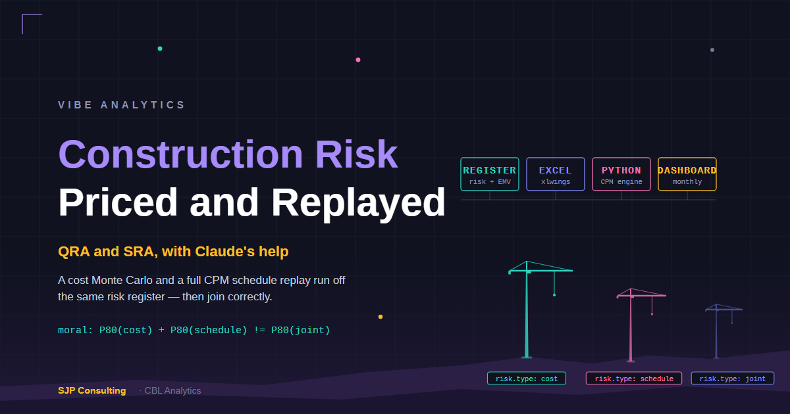

*Tropic Ridge Wind Farm is a fictional project. This post follows [Pricing Construction Risk](../2026-08-06-tropic-ridge-qra-sra/index.qmd), which set out the method and the August baseline. That post is left as it was published.*

## Why re-run it

The August numbers were internally consistent, but on a closer look the project behind them was not realistic. $50M for a 40 MW wind farm is about $1.25M per MW. Real onshore projects cost well over twice that. The schedule was also simpler than a real programme, and several risks that plainly move the finish date were coded as cost-only.

A synthetic project is only useful as a showcase if a practitioner can look at it without wincing. So Tropic Ridge was rescaled to a $120M, 40 MW project, the programme was rebuilt with a parallel substation path, and the register was reviewed and trimmed to 29 risks. Several cost-only risks that plainly move the finish were reclassified as time risks, and one was folded into a shared driver (more on those below).

Same method, same engine, same seed. Different project, so different numbers.

## Old and new

| | August | November |
|---|---|---|
| Base estimate | $50M | $120M |
| Scheduled activities | 171 | 176 |
| Risks | 35 | 29 |
| Dual-coded (cost and schedule) | 10 | 15 |
| Cost arm P80 | $5.41M | $10.97M |
| Schedule arm P80 | 53.6 days, $1.88M | 99.9 working days, $3.50M |
| Naive sum of P80s | $7.29M | $14.46M |
| Integrated P80 contingency | $6.84M (13.7%) | $14.34M (11.9%) |
| Gap, naive less integrated | $0.45M (6.6%) | $0.12M (0.9%) |

All November figures are from one production run: 100,000 iterations, seed 42, cross-validated between the two engines, and published in full at [tropicridge.cblanalytics.com/report](https://tropicridge.cblanalytics.com/report/).

## Why the gap shrank

The August post made a lot of the $450k between the naive sum and the joint simulation. On the re-run it is $120k. That is not the method failing. It is the method reporting a different register.

Percentiles do not add, because adding them assumes the bad cost year and the bad schedule year always arrive together. How far apart the naive sum and the joint figure sit depends on how much the two arms move independently. In the new register every schedule risk is also a cost risk, and those fifteen dual-coded risks make up half the register. The schedule arm is driven entirely by risks that also drive cost, so the two arms move largely together and there is little diversification left to price.

A register with more cost-only risk, or with schedule risks that carry little cost, would show a wider gap. You only find out which case you are in by running the joint model. The joint figure is the defensible one either way; the size of the saving is the register's fact, not the method's.

## Shared drivers and the owner view

Event risks are not the only thing that ties cost to time. Poor ground slows civil works and costs money at the same time. Slow erection does the same. In August the base estimate's uncertainty was modelled independently of the programme, which is a common simplification and one a reviewer would rightly query.

The re-run adds four shared drivers. Each one moves the time-dependent cost on its estimate lines and the durations of its activities from a single draw:

| Driver | Owner-view P80 it adds | Finish days it adds |
|---|---|---|
| Civil productivity and ground | $0.61M | 6.3 |
| Erection productivity | $0.25M | 1.5 |
| Electrical installation productivity | $0.27M | 1.2 |
| Grid and substation scope | $0.19M | 5.5 |

Each figure is leave-one-out: what comes off the owner-view P80 if that driver is removed.

The headline contingency stays on event risk, at $14.34M. That is the number a contractor or owner sets aside for things that may or may not happen. The drivers feed a second, owner view of the whole project:

- total cost at P80 of $146.52M, which is $26.52M above the $120M base, larger than the headline because it also carries the base estimate's own uncertainty
- P80 finish at working day 420, against 405 on event risk alone

## Joint confidence, and a correlation that stays modest

The owner view also gives a joint confidence level: the chance of meeting the budget (base plus P80 contingency) and the P80 date together. On Tropic Ridge it is 33%. There is no Australian requirement for a joint confidence level, so it sits beside the headline rather than replacing it, but it is a useful corrective for anyone who reads "P80 cost, P80 date" as "80% chance of both".

Rank correlation between total cost and finish is 0.44, up from 0.33 on the August-era setup. Event risk on its own correlates much more strongly with the finish. What weakens the link is the base estimate, much of which, turbine supply in particular, is priced up front and does not grow with the programme. On a labour-heavy project with a long build and spend that follows the S-curve, more of the cost is time-dependent, and I would expect a noticeably stronger link and a joint confidence closer to the individual P-levels.

## The point of doing this in public

Every run is seeded and stamped with its iteration count, input hashes and engine version, so the August figures can still be reproduced from the inputs and engine version they carry, and the November figures from theirs. When the inputs change, the numbers move, and the change has to explain itself. That is the discipline the platform is built around, applied to its own showcase.

*Stephen Parton is a chartered accountant and consultant with 30-plus years in finance and risk across banking and infrastructure. SJP Consulting builds quantitative risk tooling under the CBL Analytics banner. [Get in touch on LinkedIn](https://www.linkedin.com/in/stephenparton/).*
